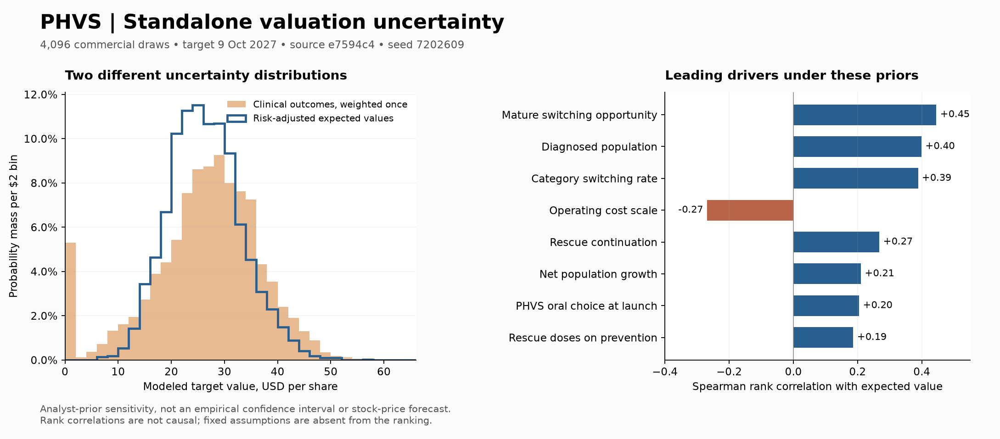

# PHVS standalone Monte Carlo — 9 October 2026

Source: [`e7594c4`](https://github.com/potpotman123/PHVS/commit/e7594c4a8e7d5f4571055e52aa9c3320b39c5ab2). Valuation date: 2026-10-09; target date: 2027-10-09.

**4,096 primary commercial draws**, plus an independent 2,048-draw seed check and twelve separate sensitivity runs with 1,024–4,096 draws each. 22,528 commercial draw/scenario evaluations; 90,112 exact conditional clinical valuations. No original repository files modified.

| Target valuation distribution, USD/share | Mean | Median | P10 | P90 |
|---|---:|---:|---:|---:|
| Clinical-risk-adjusted expected value across commercial draws | $26.38 | $25.98 | $17.84 | $35.27 |
| Conditional clinical outcomes, weighted once | $26.38 | $27.35 | $12.64 | $38.39 |

The middle 80% is an analyst-prior sensitivity range, **not** an empirical confidence interval. The second row mixes conditional business-outcome valuations. It is not a forecast of actual share-price volatility or a claim that every clinical outcome resolves by October 2027; the XR decision is later. No verified market-price reference is configured, so no probability of a profitable short or percentage downside is reported.

## What this says about the short thesis

1. **Oral preference is heterogeneous.** The prevention preference prior is 46% / 54% / 62% (minimum / mode / maximum), applied inside an opportunity → oral choice → PHVS choice → paid access process. The 54/46 survey is not observed switching and does not permanently exclude 46% of patients. Mature PHVS share of oral choices remains the favorable, user-fixed 60%.
2. **Fewer redoses reduce paid quantity.** Every simulation retains the specified 1.17/1.38 quantity factor, about a 15.2% reduction, applied once to the dose budget with initial stock accounted for inside it. This is a stipulated cross-trial-to-commercial assumption, not new evidence of realized PHVS unit economics. There is no price premium or no-redose comparison hidden in the simulation.
3. **Clinical success does not guarantee the paid ramp.** Switching opportunity, initial choice, continuation, quantity, payment intensity, overseas ramp and costs vary. Approval probabilities stay high. Historical successful oral followers remain disconfirming evidence against treating “second oral” as automatic commercial failure.

The simulation tests the financial consequences of these assumptions; it does not independently prove the three theses. The zero-volatility working case remains $28.311616929. Sampling does not have to reproduce that point: triangular modes are not means, some priors are asymmetric, and the model is nonlinear. No recentering was used.

## Paired scenarios

Same seed and primitive quantiles as the primary prefix. Each row changes one named package or structure. Access packages jointly change conversion, lag and net price. No probability weights or combined scenario distribution were invented.

| Scenario | Draws | Mean target | Median | P10–P90 | Mean change vs matched primary | Paired mean MC SE |
|---|---:|---:|---:|---:|---:|---:|
| More rebates for better access | 1,024 | $25.34 | $24.99 | $17.56–$33.92 | -$1.02 | $0.01 |
| Restricted access, higher net price | 1,024 | $24.24 | $23.80 | $16.41–$32.75 | -$2.13 | $0.01 |
| 20% extra Ekterly free supply | 1,024 | $26.20 | $25.77 | $18.11–$35.05 | -$0.16 | $0.01 |
| 15% discount rate | 1,024 | $21.47 | $21.14 | $14.73–$28.90 | -$4.89 | $0.04 |
| Free initial rescue stock | 1,024 | $25.12 | $24.76 | $17.14–$33.81 | -$1.24 | $0.01 |
| Loss of exclusivity in 2043 | 4,096 | $32.86 | $32.39 | $22.46–$43.75 | $6.48 | $0.03 |
| Overseas licensing | 1,024 | $21.63 | $21.18 | $14.38–$29.19 | -$4.73 | $0.04 |
| 10% discount rate | 1,024 | $30.44 | $29.98 | $21.13–$40.52 | $4.08 | $0.03 |
| 10% of preventive users lack rescue | 1,024 | $26.08 | $25.70 | $18.03–$35.00 | -$0.28 | <$0.01 |
| Commercial variables rank-linked | 2,048 | $26.75 | $26.71 | $12.60–$40.80 | $0.39 | $0.17 |
| Both launches delayed six months | 1,024 | $22.75 | $22.33 | $15.25–$30.92 | -$3.61 | $0.02 |
| 25% of discontinuers can return | 1,024 | $26.83 | $26.39 | $18.64–$35.86 | $0.47 | <$0.01 |

Commercial rank linking gives seven demand variables the same percentile. It is an intentionally strong dependence stress, not a fitted correlation matrix. Structural scenarios are one at a time; they are not additive and do not span all combinations.

## Clinical states and capital needs

| State | Weight | Median target/share | Median future net funding at valuation date ($m) |
|---|---:|---:|---:|
| both | 85.2632% | $28.94 | 329.6 |
| IR_only | 4.7368% | $12.06 | 251.8 |
| XR_only | 4.7368% | $14.51 | 325.4 |
| neither | 5.2632% | $0.76 | 164.4 |

These weights preserve 90% marginal success for each product using the existing 95% shared gate. No additional approval haircut is applied. Funding is a model cash requirement, not a promised financing: the inherited model assumes financing is available at its fixed issue price. Post-target funding is not charged again as extra denominator dilution after already valuing negative cash flows. Liquidation/cash assumptions explain residual value in the neither-success state.

## Numerical checks and precision

- Original engine: 152 checks passed; original Monte Carlo preflight: 72 checks passed. New runner: eight regression tests passed, including zero-volatility, exact clinical weighting, seed prefixes, worker invariance, and checkpoint hash protection.
- Primary expected-value mean Monte Carlo standard error: $0.11. Approximate P90 standard error: $0.24 for expected values and $0.23 for clinical outcomes. Eight interleaved draw clusters; not an uncertainty interval for the economic assumptions.
- Primary [2048, 4096] prefix test passes: True. Second seed passes every mean/P10/median/P90 comparison within max($0.50, 2%): True. Detailed scenario prefix checks are in analysis.json; small structural effects should be read through paired differences rather than independent quantiles.
- Every state/month is checked for population conservation, overlap, source reconciliation, cash and FCF identities, price × units and clinical failure revenue. All sampled values are finite and inside manifest bounds. Invalid draws abort with their inputs; none are discarded or replaced.
- Complete unrounded compact outputs, sampled primitive inputs, source hashes, per-scenario summaries, exact replay recipes and code are included. Full monthly paths are regenerated when needed, not stored for every simulation.

## What still limits the conclusion

- The 28 triangular distributions are analyst priors, not fitted posteriors. Increasing the draw count reduces simulation noise, not source-transfer error or selection bias.
- The diagnosed population is a broad proxy, not a validated age/genotype-eligible census. Preference surveys, mixed-cohort switching, claims dose budgets and competitor start forms do not directly measure PHVS patients or paid switching.
- IR continuation and transfer of preventive switching rates into rescue behavior remain weakly observed. The rank correlations are prior-dependent associations, not causal contributions or variance shares; fixed assumptions cannot appear in that ranking.
- No prior fitting, clinical data-misconduct claim, efficacy-to-market-share regression, new acquisition probability, or licensing payout has been invented. M&A research remains a risk to a short, but is outside this requested standalone model.
- Pricing/access packages, fixed 60% mature choice, 90% approval marginals, financing availability and post-exclusivity erosion remain important structural assumptions. Only the prespecified alternatives were run. The range does not cover every possible future.
- Current repository source registers and their updates were checked and incorporated. This run does not claim a fresh independent audit of every original paper, PDF, or licensed interview.

See [README](../README.md), [recent-update reconciliation](../RECENT_UPDATES.md), [source coverage](../source_coverage.json), and [machine-readable analysis](analysis.json).
